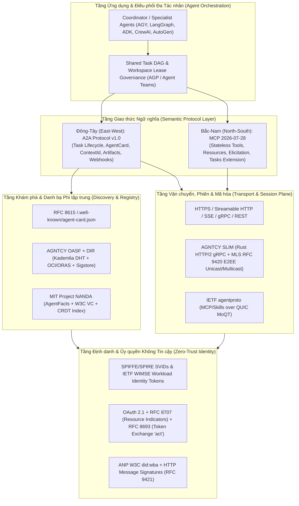
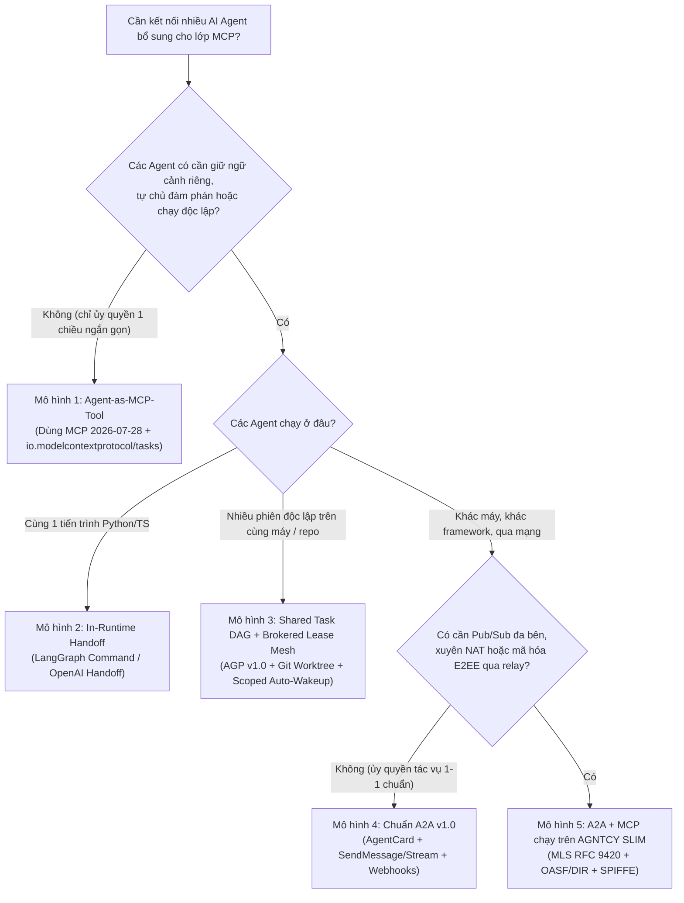
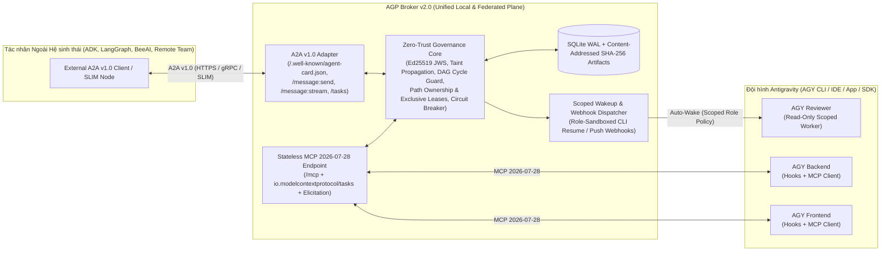

# Nghiên cứu Chuyên sâu: Kiến trúc & Giao thức Giao tiếp Liên-Agent (Inter-Agent Communication) Bổ sung cho Lớp MCP

> **Ngày cập nhật**: 23/11/2026  
> **Phạm vi nghiên cứu**: Đối chiếu trực tiếp từ các đặc tả gốc (Primary Specifications) gồm **MCP (`2026-07-28`)**, **A2A (`v1.0`)**, **AGNTCY (`SLIM`, `OASF`, `DIR`)**, **ANP (`did:wba`)**, **MIT Project NANDA (`AgentFacts`)**, **IETF (`agentproto`, `WIMSE`, `RFC 8693`, `RFC 8707`, `RFC 9420`)**, **OWASP Top 10 for Agentic Applications (`2026`)**, cùng kiểm toán kiến trúc thực tế trên mã nguồn `AGP v1.0` của dự án `agp-mcp`.

---

## Tóm tắt Điều hành (Executive Summary)

Trong kiến trúc hệ thống AI tự hành giai đoạn 2025–2026, ngành công nghiệp (dưới sự điều phối trung lập của **Agentic AI Foundation — AAIF** thuộc **Linux Foundation**) đã đi đến một sự phân tách kiến trúc mang tính nền tảng:

1. **Lớp Dọc (*Vertical / North–South Layer*) — Model Context Protocol (MCP)**: Chuẩn hóa cách **một AI Agent đơn lẻ** kết nối xuống công cụ (tools), tài nguyên dữ liệu (resources) và tương tác thu thập thông tin có cấu trúc (elicitation). Đặc biệt, bản đặc tả **MCP `2026-07-28`** đã chuyển lõi MCP sang **Stateless-first**, chuẩn hóa phần mở rộng tác vụ nền `io.modelcontextprotocol/tasks`, đồng thời **chính thức loại bỏ (`deprecate`) tính năng `sampling/createMessage` theo đề xuất SEP-2577**. Quyết định này vạch rõ ranh giới: **MCP không phải và sẽ không trở thành giao thức điều phối ngang hàng giữa các Agent.**
2. **Lớp Ngang (*Horizontal / East–West Layer*) — Inter-Agent Communication**: Để nhiều AI Agent độc lập (khác cửa sổ phiên, khác runtime/framework, khác nhóm phát triển hoặc xuyên tổ chức) cộng tác an toàn, hệ thống bắt buộc phải có một lớp giao tiếp bổ sung phía trên hoặc song song với MCP để giải quyết **7 bài toán mà MCP không đảm nhận**:
   - **Khám phá năng lực động & Xác thực danh tính tác nhân** (*Agent Cards*, *OASF/DHT*, *DID/SPIFFE*).
   - **Thực thi hộp đen (*Opaque Execution*)**: Cộng tác theo mục tiêu mà không phơi bày system prompt, bộ nhớ nội bộ hay danh sách tool riêng của từng Agent.
   - **Vòng đời tác vụ đa vòng có trạng thái (*Stateful Multi-Turn Collaboration*)**: Đàm phán, hỏi làm rõ (`INPUT_REQUIRED`), tạm dừng chờ xác thực (`AUTH_REQUIRED`), bàn giao kết quả (`Artifact`).
   - **Truyền thông chủ động (*Push / Auto-Wakeup / Pub-Sub / Multicast*)**: Đánh thức Agent đang rảnh hoặc phát sóng sự kiện nhóm với độ trễ thấp và mã hóa đầu-cuối (**MLS — RFC 9420**).
   - **Quản trị xung đột tài nguyên chung (*Workspace Leases, Shared Task DAG, Git Worktree Handoff*)**: Thiết yếu đối với các Coding Agents cùng thao tác trên một kho mã nguồn.
   - **Ngân sách ngữ cảnh (*Context Budget*) & Truyền tải theo tham chiếu (*Pass-by-Reference*)**: Ngăn chặn hiện tượng phình ngữ cảnh cấp số nhân qua nhiều chặng Agent.
   - **Phòng thủ *Prompt Infection* liên-Agent & Chuỗi ủy quyền không chuyển tiếp token (*Zero Token Passthrough*)**.

> [!IMPORTANT]
> **Kết luận cốt lõi cho kiến trúc sư hệ thống**: Đừng cố nhồi nhét toàn bộ giao tiếp liên-Agent vào các lệnh gọi `tools/call` đồng bộ của MCP, và cũng đừng dùng một giao thức HTTP hạng nặng duy nhất cho mọi quy mô. Kiến trúc chuẩn xác nhất hiện nay là **Mô hình Phân tầng Kết hợp (Hybrid Layered Mesh)**:
> - **Nội bộ Agent → Công cụ**: Dùng **MCP (`2026-07-28` Streamable HTTP / Stdio + `io.modelcontextprotocol/tasks`)**.
> - **Giữa các Agent cùng máy / cùng dự án (Coding Fleet)**: Dùng **Local Broker + Shared Task DAG + File Lease + Auto-Wakeup** (như `AGP v1.0` + `TeamManager`, được gia cố bảo mật định danh bất đối xứng và quyền sandbox).
> - **Giữa các Agent khác hệ sinh thái / xuyên dịch vụ doanh nghiệp**: Xuất bản cổng **A2A Protocol `v1.0`** (`/.well-known/agent-card.json` + JSON-RPC/gRPC/REST).
> - **Khi cần Pub/Sub đa bên độ trễ thấp hoặc xuyên đám mây Zero-Trust**: Đặt A2A và MCP chạy trên tầng vận chuyển **AGNTCY SLIM (MLS RFC 9420)**.

---

## 1. Giải phẫu Giới hạn của Lớp MCP (`2026-07-28`) trước Bài toán Đa Tác nhân

### 1.1. Sự tiến hóa của MCP tính đến bản đặc tả `2026-07-28`

Để bổ sung đúng thứ lớp MCP còn thiếu, trước hết cần nắm chính xác những gì MCP **đã có** ở thế hệ mới nhất ([MCP Specification `2026-07-28`](https://modelcontextprotocol.io/specification/2026-07-28)):

- **Lõi Không Trạng thái (*Stateless-First Core*) & Streamable HTTP**: Loại bỏ bắt buộc bắt tay phiên `initialize` giữ trạng thái (`Mcp-Session-Id`) của thế hệ `2025-03-26`/`2025-06-18`. Mỗi request tự mô tả qua `_meta` và các HTTP routing headers (`MCP-Protocol-Version`, `Mcp-Method`, `Mcp-Name`), cho phép đặt MCP Server sau bộ cân bằng tải round-robin tiêu chuẩn.
- **Multi Round-Trip Requests (MRTR) & Elicitation (`elicitation/create`)**: Cho phép MCP Server tạm dừng giữa chừng (`input_required`) để yêu cầu phía Client thu thập thêm thông tin từ người dùng qua **Form Mode** (JSON Schema an toàn, cấm hỏi mật khẩu/API key) hoặc **URL Mode** (luồng OAuth/xác thực ngoài).
- **Phần mở rộng Tác vụ Bất đồng bộ Chính thức (`io.modelcontextprotocol/tasks`)**: Tiến hóa từ bản thử nghiệm `2025-11-25` (vốn có 4 phương thức `tasks/get`, `tasks/list`, `tasks/result`, `tasks/cancel`), bản `2026-07-28` tách Tasks thành extension chuẩn hóa tinh gọn còn **3 phương thức**:
  1. `tasks/get`: Lấy trạng thái hiện tại (`working`, `input_required`, `completed`, `failed`, `cancelled`) và trả luôn kết quả cuối cùng inline khi hoàn tất (thay thế `tasks/result`).
  2. `tasks/update`: Cung cấp dữ liệu bổ sung giữa chừng khi tác vụ ở trạng thái `input_required`.
  3. `tasks/cancel`: Gửi tín hiệu hủy tác vụ hợp tác (*cooperative cancellation*).
- **Bước ngoặt SEP-2577 (*Deprecate Roots, Sampling, and Logging*)**: Đặc tả MCP chính thức ngừng khuyến nghị và lên lộ trình loại bỏ `sampling/createMessage`, `roots/list` và giao thức logging nội bộ. Lý do cốt lõi của SEP-2577 là **làm sạch ranh giới tin cậy (trust boundary)**: việc cho phép một MCP Server bên ngoài mượn ngược LLM của Client qua `sampling/createMessage` tạo ra bề mặt tấn công *nested prompt injection* và nhập nhằng trách nhiệm chi phí/quyền hạn.
- **Bảo mật OAuth 2.1 & Cấm *Token Passthrough*** ([MCP Authorization](https://modelcontextprotocol.io/specification/2026-07-28/basic/authorization), [Security Best Practices](https://modelcontextprotocol.io/specification/2026-07-28/basic/security_best_practices)): Bắt buộc dùng **RFC 8707 Resource Indicators** để gắn chặt token vào đúng URI của từng MCP Server; nghiêm cấm MCP Server nhận access token của Client rồi chuyển tiếp nguyên xi (*passthrough*) sang API hạ nguồn nhằm chặn lỗi **Confused Deputy**.

### 1.2. Tại sao chỉ dùng MCP (kể cả mẫu *"Agent-as-MCP-Tool"*) vẫn không đủ?

Nhiều hệ thống ban đầu thử kết nối đa Agent bằng cách biến Agent B thành một MCP Server và phơi bày hàm `ask_agent_b(prompt)` cho Agent A gọi như một công cụ. Cách tiếp cận này chạy được cho tác vụ con đơn giản, nhưng gặp **7 điểm nghẽn kiến trúc** khi đưa vào môi trường thực tế:

| Khía cạnh Kỹ thuật | Bản chất của MCP (`Client → Tool Server`) | Yêu cầu thực sự của Giao tiếp Liên-Agent (`Peer ↔ Peer`) |
| :--- | :--- | :--- |
| **1. Mô hình Tư duy & Đối xứng** | **Bất đối xứng (Chủ – Tớ)**: Client điều khiển hoàn toàn; Tool là hàm xác định (deterministic schema) bị gọi thụ động. | **Ngang hàng & Tự chủ (Peer Autonomy)**: Mỗi Agent có vòng lặp suy luận riêng, có quyền từ chối (`REJECTED`), đề xuất lại phạm vi, hoặc chủ động nhắn tin cho đồng đội. |
| **2. Ngữ cảnh Hội thoại Đa vòng** | Mỗi lệnh `tools/call` (hoặc `task`) là một đơn vị thực thi rời rạc; không có khái niệm luồng hội thoại liên tác vụ. | Cần `contextId` / `correlation_id` xuyên suốt nhiều tác vụ để hai chuyên gia tranh luận, làm rõ giả định, review mã nguồn qua nhiều vòng. |
| **3. Khám phá Năng lực Động** | Client phải biết trước URL/command của MCP Server trong file cấu hình tĩnh (`mcp_config.json`), sau đó gọi `tools/list`. | Hàng chục Agent sinh/hủy động cần tự đăng ký **Agent Card** kèm kỹ năng (`skills`), quyền sở hữu thư mục (`owned_paths`), trạng thái tải (`busy`/`idle`) và chữ ký số xác thực. |
| **4. Thông báo Đẩy & Đánh thức (Wakeup)** | Thuần túy **Client-pull** (HTTP POST / polling `tasks/get`). Server không thể chủ động đánh thức một Client đã đóng kết nối. | Khi Agent Backend sửa xong API lúc 2 giờ sáng hoặc sau 10 phút build, hệ thống phải **đẩy webhook (`PushNotificationConfig`)** hoặc **auto-wake** phiên Agent Frontend đang ngủ. |
| **5. Giao tiếp Đa bên (Group / Pub-Sub)** | Kết nối điểm-tới-điểm (1 Client ↔ 1 Server). Không có khái niệm kênh nhóm, broadcast, hay multicast mã hóa. | Một thay đổi hợp đồng dữ liệu (OpenAPI schema) cần phát tới đồng thời Backend, Frontend, QA và Security Agent trên một bus chung. |
| **6. Điều phối Tài nguyên Vật lý Chung** | MCP không có nguyên thủy khóa tài nguyên (lock/lease) hay phân giải xung đột ghi đồng thời giữa nhiều Client. | Hai Coding Agents cùng sửa một file hoặc cùng chạy migration DB sẽ ghi đè nhau nếu thiếu **TTL File Lease**, **Path Ownership** hoặc **Git Worktree Handoff**. |
| **7. Quản trị Chuỗi Ủy quyền & Chi phí** | Không có bộ đếm bước nhảy (`hop_count`/`max_hops`), không có phát hiện chu trình đồ thị (`DAG cycle`), không có ngân sách token liên chặng. | Dễ rơi vào vòng lặp ping-pong vô tận giữa 2–3 Agent làm cạn quota token hoặc khuếch đại lỗi ảo giác dây chuyền (*Cascading Failures*). |

---

## 2. Hệ sinh thái Chuẩn Mở Bổ sung cho Lớp MCP (Cập nhật Cuối 2026)

Toàn bộ bức tranh chuẩn hóa giao tiếp AI Agent hiện đại có thể được hình dung qua kiến trúc phân tầng dưới đây:



### 2.1. A2A Protocol `v1.0` (Agent2Agent — Chuẩn Ngang hàng Chủ lực của Linux Foundation / AAIF)

- **Nguồn gốc & Quản trị**: Khởi xướng bởi Google (04/2025), tiếp nhận hợp nhất toàn bộ giao thức **ACP (Agent Communication Protocol)** của IBM Research / BeeAI vào ngày **25/08/2025** (kho `i-am-bee/acp` chính thức đóng băng chuyển sang A2A để tránh phân mảnh chuẩn), và phát hành bản ổn định sản xuất **A2A `v1.0` vào tháng 03/2026** dưới mái nhà **Agentic AI Foundation (AAIF — Linux Foundation)** ([a2a-protocol.org](https://a2a-protocol.org/), [`a2aproject/A2A`](https://github.com/a2aproject/A2A)).
- **Nguồn Chân lý Duy nhất (`specification/a2a.proto`)**: Từ bản `v1.0` ([Normative Spec](https://a2a-protocol.org/latest/specification/), [`specification/a2a.proto`](https://github.com/a2aproject/A2A/blob/main/specification/a2a.proto)), toàn bộ mô hình dữ liệu được định nghĩa chuẩn tắc bằng Protocol Buffers (`proto3`) và ánh xạ đồng nhất ra **3 chuẩn vận chuyển**: **JSON-RPC 2.0**, **gRPC**, và **HTTP+JSON (REST)**, thương lượng phiên bản qua HTTP header `A2A-Version: 1.0`.
- **Cơ chế Khám phá qua `AgentCard` (`/.well-known/agent-card.json` — RFC 8615)**:
  - Khai báo danh tính (`name`, `description`, `version`, `provider`), danh sách giao diện theo thứ tự ưu tiên (`supportedInterfaces[]` gồm `{ url, protocolBinding: "JSONRPC"|"GRPC"|"HTTP+JSON", protocolVersion, tenant? }` — hợp nhất `preferredTransport` cũ của v0.3), kiểu MIME mặc định (`defaultInputModes`, `defaultOutputModes`), năng lực giao thức (`capabilities`: `streaming`, `pushNotifications`, `stateTransitionHistory`, `extendedAgentCard`), danh mục kỹ năng nghiệp vụ (`skills[]` kèm `id`, `tags`, `examples`, `inputModes`, `outputModes`, `securityRequirements`), và yêu cầu xác thực (`securitySchemes` theo OpenAPI 3.x: API Key, HTTP Bearer, OAuth2, OIDC, mTLS — luôn truyền ở HTTP/gRPC header, không bao giờ nhét vào body JSON-RPC).
  - **Chữ ký số `AgentCardSignature`**: Ký toàn vẹn thẻ Agent bằng **RFC 7515 JSON Web Signature (JWS)** tính trên biểu diễn chuẩn hóa **RFC 8785 (JCS)** để chống giả mạo danh bạ.
  - **Thẻ Mở rộng Có xác thực (`GetExtendedAgentCard`)**: Cho phép xuất bản một `AgentCard` công khai tối giản ở `/.well-known/agent-card.json`, và chỉ tiết lộ các kỹ năng nhạy cảm/nội bộ sau khi Client xác thực thành công.
- **Bảo mật Webhook cho Tác vụ Dài hạn (`PushNotificationConfig`)**: Khi gửi callback bất đồng bộ tới `url` của Client, A2A Server xác thực chiều đi bằng **Bearer JWT bất đối xứng + JWKS** (ký bởi khóa riêng của Agent kèm `iss`, `aud`, `iat`, `exp`, `jti`) kết hợp đối chiếu chuỗi `token` định danh phiên (`X-A2A-Notification-Token`), đồng thời chặn dải IP nội bộ ở phía Server để phòng chống tấn công **SSRF**.
- **Hệ thống Phương thức Chuẩn của `A2AService` (`v1.0`)**:

| Hoạt động Trừu tượng (`a2a.proto`) | JSON-RPC 2.0 (`v0.3` → `v1.0`) | HTTP+JSON / REST Binding | Vai trò trong Giao tiếp Liên-Agent |
| :--- | :--- | :--- | :--- |
| **`SendMessage`** | `message/send` → `SendMessage` | `POST /message:send` (hoặc `/{tenant}/message:send`) | Gửi một lượt thông điệp; trả về `SendMessageResponse` (`oneof`: `Task` dài hạn hoặc `Message` phản hồi tức thì). |
| **`SendStreamingMessage`** | `message/stream` → `SendStreamingMessage` | `POST /message:stream` (SSE) | Khởi tạo/tiếp tục tác vụ và nhận luồng sự kiện thời gian thực (`TaskStatusUpdateEvent`, `TaskArtifactUpdateEvent`). |
| **`GetTask`** | `tasks/get` → `GetTask` | `GET /tasks/{id}` | Truy vấn trạng thái hiện tại, lịch sử thông điệp và danh sách `Artifact` của một tác vụ theo UUID. |
| **`ListTasks`** | `tasks/list` → `ListTasks` | `GET /tasks` | Liệt kê/lọc các tác vụ theo `contextId`, trạng thái hoặc mốc thời gian. |
| **`CancelTask`** | `tasks/cancel` → `CancelTask` | `POST /tasks/{id}:cancel` | Yêu cầu hủy tác vụ đang chạy một cách có kiểm soát. |
| **`SubscribeToTask`** | `tasks/resubscribe` → `SubscribeToTask` | `POST /tasks/{id}:subscribe` | Kết nối lại vào luồng SSE/gRPC stream của một tác vụ dài hạn sau khi đứt mạng. |
| **`GetExtendedAgentCard`** | `agent/getAuthenticatedExtendedCard` → `GetExtendedAgentCard` | `GET /extendedAgentCard` (hoặc `/v1/card`) | Lấy hồ sơ kỹ năng chi tiết sau khi đã xác thực quyền truy cập. |
| **`*TaskPushNotificationConfig`** | `tasks/pushNotificationConfig/{set,get,list,delete}` | `POST/GET/DELETE /tasks/{id}/pushNotificationConfigs` | Đăng ký **Webhook URL** kèm thông tin xác thực để Agent đích chủ động đẩy thông báo khi tác vụ đổi trạng thái. |

- **Mô hình Dữ liệu Trạng thái & Đa phương thức**:
  - **`contextId` & `Task`**: Một `contextId` gom nhóm nhiều `Task` và `Message` liên quan nhau trong cùng một phiên cộng tác. Vòng đời `TaskState` chuẩn hóa ở dạng `SCREAMING_SNAKE_CASE`: `TASK_STATE_SUBMITTED`, `TASK_STATE_WORKING`, `TASK_STATE_INPUT_REQUIRED`, `TASK_STATE_AUTH_REQUIRED`, `TASK_STATE_COMPLETED`, `TASK_STATE_CANCELED`, `TASK_STATE_FAILED`, `TASK_STATE_REJECTED`.
  - **`Part` & `Artifact`**: Trong `v1.0`, `Part` được hợp nhất thành cấu trúc phẳng `oneof content` (`text`, `raw` bytes, `url` tham chiếu, hoặc `data` JSON `protobuf.Value`) kèm `mediaType`, `filename` và `metadata`. Các luồng `SendStreamingMessage` / `SubscribeToTask` phát khung `StreamResponse` hỗ trợ ghép mảnh tuần tự `TaskArtifactUpdateEvent` (`append: true`, `lastChunk: true`).
  - **Cơ chế Mở rộng (`A2A-Extensions`)**: Cho phép gắn thêm các khả năng chuyên biệt theo miền (ví dụ: khóa file mã nguồn, ngân sách chi phí, bằng chứng kiểm thử) thông qua `AgentExtension` (`{ uri, description, required, params }`) trong `capabilities.extensions[]` và kích hoạt qua HTTP header `A2A-Extensions` (nếu `required: true` mà Client bỏ qua, Server trả lỗi chuẩn `ExtensionSupportRequiredError`).

### 2.2. AGNTCY Stack: `SLIM`, `OASF` & `DIR` (Hạ tầng Mạng & Nhóm Mã hóa Đầu-Cuối)

Dù A2A `v1.0` giải quyết xuất sắc bài toán ngữ nghĩa ủy quyền tác vụ, các kết nối HTTP/REST truyền thống vẫn gặp khó khăn khi: (1) Agent nằm sau NAT/Firewall không thể mở cổng public nhận webhook, (2) cần giao tiếp nhóm **Pub/Sub / Multicast** tốc độ cao giữa hàng chục Agent, hoặc (3) Broker trung gian không được phép đọc nội dung nhạy cảm. Dự án **AGNTCY** thuộc Linux Foundation ([agntcy.org](https://agntcy.org/), [`agntcy/slim`](https://github.com/agntcy/slim)) bổ sung chính xác mảnh ghép hạ tầng này:

1. **SLIM (*Secure Low-Latency Interactive Messaging*)**:
   - Viết bằng **Rust/Tokio**, tách bạch hoàn toàn **Data Plane** (định tuyến gói tin tốc độ dây dựa trên nhãn băm 64-bit trên luồng gRPC/HTTP2 hai chiều, WebSockets hoặc QUIC; các Agent biên chỉ cần mở kết nối chiều ra tới relay nên xuyên NAT/Firewall không cần mở cổng ingress) khỏi **Session Layer**.
   - **Định danh & Định tuyến Phân cấp (*Hierarchical Naming*)**: Mỗi thực thể mang địa chỉ 4 phần `organization/namespace/service/instanceHash`. Ba thành phần đầu (`organization/namespace/service`) định danh kênh nhóm logic — hỗ trợ cả **Anycast** (gửi yêu cầu đầu tiên tới một replica khỏe mạnh rồi tự động ghim *sticky session affinity* vào `instanceHash` cho các lượt sau) lẫn **Multicast/Pub-Sub** tới toàn bộ thành viên nhóm; thành phần thứ tư (`instanceHash`) định danh duy nhất từng replica để gửi **Unicast**.
   - **Mã hóa Đầu-Cuối bằng MLS (RFC 9420 — *Messaging Layer Security*)**: Khác với TLS thông thường bị giải mã tại reverse proxy hoặc message broker trung gian, SLIM thiết lập phiên **MLS** trực tiếp giữa các đầu cuối Agent. Nhờ cấu trúc cây khóa **TreeKEM** độ phức tạp $O(\log N)$, MLS đảm bảo cả **Forward Secrecy (FS)** lẫn **Post-Compromise Security (PCS)** khi thêm/bớt Agent trong nhóm động — ngay cả khi nút định tuyến SLIM bị xâm nhập, kẻ tấn công không thể đọc mã nguồn hay kế hoạch trao đổi.
   - **Tương thích Trong suốt (`slim-a2a` & `slim-mcp`)**: Cung cấp binding `SLIMRPC` cho phép chạy nguyên bản cả giao thức **A2A** (`agntcy/slim-a2a-python`, `agntcy/slim-a2a-go`) lẫn **MCP** (`agntcy/slim-mcp-python`, `agntcy/slim-mcp-rust`) bên trên đường ống SLIM.
2. **OASF (*Open Agentic Schema Framework* — [`agntcy/oasf`](https://github.com/agntcy/oasf)) & Agent Directory (`DIR` — [`agntcy/dir`](https://github.com/agntcy/dir))**:
   - Đóng vai trò "DNS phi tập trung có xác thực cho Agent": Hồ sơ năng lực theo chuẩn OASF được lưu trữ bất biến theo địa chỉ nội dung (**Content-Addressable OCI/ORAS Artifacts**), lập chỉ mục phân tán qua mạng ngang hàng **Kademlia DHT**, và ký xác thực nguồn gốc bằng **Sigstore** + **SPIFFE**.

### 2.3. ANP (*Agent Network Protocol*) & MIT Project NANDA (Mạng Mở Phi Tập Trung)

Khi bài toán vượt ra khỏi phạm vi nội bộ một công ty để tiến tới các chợ Agent mở trên Internet:

- **ANP ([agent-network-protocol.com](https://agent-network-protocol.com/), [`AgentNetworkProtocol`](https://github.com/agent-network-protocol/AgentNetworkProtocol))**: Thiết kế kiến trúc 3 tầng hướng ngang hàng thuần túy:
  1. *Identity & E2EE Layer*: Đề xuất phương thức định danh phi tập trung W3C **`did:wba`** (*Web-Based Agent DID*) mở rộng từ `did:web` — tận dụng hạ tầng DNS/HTTPS sẵn có (không cần blockchain) kết hợp **RFC 9421 (HTTP Message Signatures)** để hai Agent từ hai nền tảng bất kỳ tự xác thực chéo khóa công khai.
  2. *Meta-Protocol Layer*: Cho phép hai Agent thương lượng động về định dạng schema và giao thức giao tiếp tối ưu ngay lúc chạy.
  3. *Application Protocol Layer*: Mô tả năng lực và giao dịch bằng ngữ nghĩa liên kết **JSON-LD / Schema.org**.
- **MIT Project NANDA (*Networked Agents and Decentralized AI* — [mit.edu](https://nanda.media.mit.edu/))**: Giải quyết sự phân mảnh danh bạ bằng cấu trúc **"Quilt Registry"** siêu nhẹ cùng chứng chỉ **`AgentFacts`** (dựa trên **W3C Verifiable Credentials** và đồng bộ **CRDT** dưới 1 giây), đóng vai trò lớp cầu nối tra cứu xuyên suốt giữa MCP Servers, A2A Agent Cards và ANP Peers.

### 2.4. Nhóm Đặc trách IETF `agentproto` & `WIMSE` (Chuẩn hóa Tầng Internet & Ủy quyền)

Ở tầng giao thức mạng lõi của IETF ([IETF `agentproto` WG](https://datatracker.ietf.org/wg/agentproto/documents/)), các nỗ lực chuẩn hóa năm 2026 đang tập trung vào:

- **`draft-jennings-agentproto-mcp-over-moqt`**: Vận chuyển MCP và kỹ năng Agent qua giao thức **Media over QUIC Transport (MoQT)** nhằm đạt độ trễ cực thấp và ghép kênh luồng lớn không bị nghẽn đầu dòng (*head-of-line blocking*).
- **`draft-feng-agentproto-session-requirements`** & **`draft-bu-agentproto-security-principal-binding`**: Chuẩn hóa phiên hội thoại liên-Agent và gắn kết chặt chẽ danh tính người ủy quyền gốc vào phiên làm việc.
- **Bộ đôi SPIFFE/WIMSE + RFC 8693 OAuth 2.0 Token Exchange**: Chuẩn mực vàng cho định danh và ủy quyền đa chặng (sẽ phân tích chi tiết ở Mục 4.2).

### 2.5. Ma trận So sánh Tổng hợp các Giao thức trong Ngăn xếp Agent

| Tiêu chí | MCP (`2026-07-28`) | A2A (`v1.0` — AAIF) | AGNTCY (`SLIM` + `DIR`) | ANP (`did:wba`) | Local Broker (`AGP v1.0`) |
| :--- | :--- | :--- | :--- | :--- | :--- |
| **Hướng kết nối chính** | Dọc: `Agent → Tool/Resource` | Ngang: `Agent ↔ Agent` | Hạ tầng mạng & Danh bạ cho A2A/MCP | Ngang mở trên Internet P2P | Ngang cục bộ / Nhóm Coding Agents |
| **Trạng thái phiên lõi** | Stateless-first + `tasks` extension | Stateful `Task` + `contextId` | Stateful MLS Sessions (Unicast/Group) | Stateless HTTP + E2EE DID Session | SQLite WAL Queue + File Mailboxes |
| **Vận chuyển (Transport)** | Streamable HTTP, Stdio | JSON-RPC 2.0, gRPC, HTTP+JSON, SSE | gRPC/HTTP2, WebSockets (`SLIMRPC`) | HTTPS + JSON-LD | Streamable HTTP (`/mcp`) + OS Hooks |
| **Khám phá (Discovery)** | Tĩnh hoặc MCP Registry | `/.well-known/agent-card.json` | OASF + Kademlia DHT + OCI | `did:wba` + Search/ADP JSON-LD | `agp_discover` + Transcript Scanner |
| **Pub/Sub & Multicast** | Không | Không (chỉ 1-1 + Webhook) | **Có (Native Group Multicast)** | Hạn chế | Broadcast kênh `all` / Team |
| **Mã hóa Đầu-Cuối (E2EE)** | Phụ thuộc TLS vận chuyển | Phụ thuộc HTTPS/mTLS + JWS Card | **MLS (RFC 9420) xuyên Broker** | **E2EE dựa trên khóa DID** | HMAC-SHA256 cục bộ (`broker.key`) |
| **Quản lý Khóa File/Repo** | Không | Không (cần viết A2A Extension) | Không | Không | **Có sẵn (`agp_lease` + `PreToolUse`)** |

---

## 3. Năm Mô hình Kiến trúc Thực chiến để Bổ sung Giao tiếp Liên-Agent cho Lớp MCP

Từ góc nhìn kiến trúc hệ phân tán, không có một mô hình duy nhất tối ưu cho mọi bài toán. Dưới đây là **5 mẫu kiến trúc chuẩn** xếp theo mức độ tách rời (decoupling) tăng dần, kèm điều kiện áp dụng và điểm gãy thực tế:

### Mô hình 1 — *Agent-as-MCP-Tool* (Phân cấp Đóng gói qua MCP)

```text
Orchestrator Agent ──(MCP tools/call + io.modelcontextprotocol/tasks)──▶ Specialist Agent (bọc trong MCP Server)
```

- **Cơ chế**: Specialist Agent ẩn toàn bộ vòng lặp LLM + công cụ nội bộ đằng sau một MCP Server chỉ phơi bày 1–2 tool cấp cao (ví dụ `run_security_audit`). Nếu chạy lâu, Server trả về `resultType: "task"` để Orchestrator gọi `tasks/get`.
- **Khi nào nên dùng**: Tác vụ con độc lập, đầu vào/đầu ra rõ ràng, không cần trao đổi qua lại nhiều vòng, muốn tận dụng ngay hạ tầng MCP Client sẵn có mà không thêm giao thức mới.
- **Điểm gãy ở Production**: Orchestrator trở thành nút cổ chai duy nhất; Specialist không thể chủ động hỏi ngang sang một Specialist khác; mất khả năng duy trì `contextId` xuyên nhiều tác vụ liên tiếp.

### Mô hình 2 — *In-Runtime Control Handoff* (Chuyển giao Quyền Điều khiển Nội bộ)

```text
Triage Agent ──handoff(context_filter)──▶ Backend Agent ──handoff()──▶ QA Agent (cùng tiến trình/graph)
```

- **Cơ chế**: Đại diện bởi **OpenAI Agents SDK (`handoff()`)** và **LangGraph (`Command(goto=..., graph=Command.PARENT)`)**. Thay vì gọi Agent B như hàm con rồi quay lại Agent A, Agent A chuyển hẳn quyền điều khiển luồng hội thoại (cùng bộ lọc lịch sử đã cắt gọn) sang Agent B.
- **Khi nào nên dùng**: Luồng xử lý tuần tự hoặc định tuyến yêu cầu người dùng trong **cùng một codebase Python/TypeScript** cần độ trễ cực thấp (không tốn chi phí serialize qua mạng).
- **Điểm gãy ở Production**: Khóa chặt vào một framework duy nhất; không thể kết nối một phiên CLI ở cửa sổ A với một phiên IDE ở cửa sổ B hoặc một Agent viết bằng ngôn ngữ khác.

### Mô hình 3 — *Shared Mailbox + DAG Task Board + Auto-Wakeup* (Mô hình Nhóm Coding Agents Cục bộ)

```text
Lead Agent ──▶ Shared Task DAG (claim / blocked_by / auto-unblock) ◀── Teammate A & Teammate B
                       ▲                                                      │
                       └────────── Per-Agent Mailboxes + CLI Auto-Wakeup ─────┘
```

- **Cơ chế**: Đại diện bởi **Claude Code Agent Teams (`~/.claude/teams/`)** và **`TeamManager` trong `agp-mcp` (`~/.gemini/agp/teams/`)**. Mỗi thành viên là một phiên Agent độc lập có cửa sổ ngữ cảnh riêng (`conversation_id` bền vững), tự nhận việc nguyên tử (*atomic claim*) trên bảng `tasks.json` có ràng buộc phụ thuộc `blocked_by`, gửi tin nhắn trực tiếp ngang hàng vào `inboxes/<name>.json`, và được trình điều phối nền tự động đánh thức khi có tin mới.
- **Khi nào nên dùng**: Nhiều Coding Agents cộng tác song song trên cùng máy trạm hoặc cùng monorepo (Backend + Frontend + Test + Reviewer).
- **Điểm gãy ở Production**: Nếu thiếu **File Lease Guard** hoặc **Git Worktree Isolation**, hai Agent dễ sửa đè cùng một tệp; nếu cơ chế wakeup bỏ qua kiểm tra quyền (như cờ `--dangerously-skip-permissions`), một tin nhắn bị nhiễm *prompt injection* có thể leo thang đặc quyền sang đồng đội.

### Mô hình 4 — *Federated Peer Delegation* (A2A `v1.0` Ngang hàng + MCP Nội bộ)

```text
[Agent A + bộ MCP Tools riêng] ◀═══ A2A v1.0 (AgentCard + Task + Artifact + Webhook) ═══▶ [Agent B + bộ MCP Tools riêng]
```

- **Cơ chế**: Mỗi Agent dùng **MCP** ở tầng dọc để thao tác cơ sở dữ liệu/tệp tin của riêng nó, nhưng giao tiếp với các Agent khác qua chuẩn **A2A `v1.0`**. Không Agent nào nhìn thấy MCP tools hay bộ nhớ thô của Agent kia (*Opaque Boundary*).
- **Khi nào nên dùng**: Hệ thống đa dịch vụ doanh nghiệp, tích hợp giữa các nhóm dùng khác framework (ví dụ: Antigravity CLI gọi sang dịch vụ Agent chạy trên Google ADK, LangGraph hoặc BeeAI), hoặc cần chạy tác vụ bất đồng bộ kéo dài hàng giờ qua `PushNotificationConfig`.
- **Điểm gãy ở Production**: Điểm-nối-điểm qua HTTP không tự có cơ chế khóa tài nguyên chung hay phát sóng nhóm (cần kết hợp thêm Broker hoặc A2A Extension nếu dùng cho đồng sửa đổi mã nguồn).

### Mô hình 5 — *Encrypted Event Bus & Moderated Broker Mesh* (SLIM / Actor Mesh)

```text
Agent A ──┐                                                                    ┌──▶ Agent C
          ├──▶ [SLIM Data Plane (MLS E2EE) / AGP Governance Broker + Leases] ──┤
Agent B ──┘                                                                    └──▶ Agent D
```

- **Cơ chế**: Đại diện bởi **Microsoft AutoGen Core (Virtual Actors)** ở tầng runtime và **AGNTCY SLIM + AGP Broker** ở tầng mạng. Các Agent giao tiếp thông qua định danh phân cấp và kênh sự kiện có kiểm duyệt (Schema Validation, Circuit Breaker, Lease Manager, Taint Tracking, MLS E2EE).
- **Khi nào nên dùng**: Hệ thống quy mô lớn, đa đám mây/xuyên NAT, cần fan-out/fan-in thời gian thực tới nhiều chuyên gia đánh giá song song hoặc yêu cầu bảo mật Zero-Trust ngay cả trên tầng vận chuyển trung gian.
- **Điểm gãy ở Production**: Độ phức tạp vận hành và gỡ lỗi cao nhất — **bắt buộc** phải có Distributed Tracing (`trace_id`, `parent_span_id`), giới hạn `max_hops`, phát hiện chu trình DAG và điều phối viên (*Moderator/Coordinator*) theo nguyên tắc *Hierarchical-first*.

### Cây Quyết định Lựa chọn Kiến trúc Bổ sung cho MCP



---

## 4. Bảo mật, Ngân sách Ngữ cảnh & Kỹ thuật Chịu lỗi Hệ Phân tán

Một hệ thống đa Agent đẹp trên bản demo sẽ sụp đổ nhanh chóng trên môi trường thật nếu bỏ qua ba trụ cột kỹ thuật dưới đây.

### 4.1. Mô hình Mối đe dọa theo **OWASP Top 10 for Agentic Applications (2026)** & **Prompt Infection**

Khung tham chiếu bảo mật chính thức **[OWASP Top 10 for Agentic Applications 2026 (`ASI01`–`ASI10`)](https://genai.owasp.org/resource/owasp-top-10-for-agentic-applications-for-2026/)** chuyển dịch triết lý từ *Least Privilege* sang **Least Agency (Tối thiểu hóa Quyền Tự quyết)** và chỉ mặt đặt tên các rủi ro trực tiếp liên quan tới giao tiếp liên-Agent:

- **`ASI07 — Insecure Inter-Agent Communication`**: Giả mạo danh tính người gửi (*spoofing*), phát lại gói tin cũ (*replay*), sửa đổi thông điệp trên bus hoặc tiêm chỉ thị độc hại qua lời thoại giữa các Agent.
- **`ASI01 — Agent Goal Hijack` & Virus *"Prompt Infection"* ([Lee & Tiwari, arXiv:2410.07283](https://arxiv.org/abs/2410.07283))**: Khi Agent A đọc tài liệu ngoài chứa mã độc gián tiếp (*indirect prompt injection*), mã độc không chỉ chiếm quyền Agent A mà còn **tự nhân bản vào thông điệp gửi sang Agent B, C** giống như virus máy tính.
- **`ASI03 — Identity & Privilege Abuse` & `ASI05 — Unexpected Code Execution (RCE)`**: Một Agent chỉ có quyền đọc web lại mượn tay một Coding Agent có quyền chạy shell để thực thi lệnh phá hoại (*cross-agent confused deputy*).
- **`ASI06 — Memory & Context Poisoning` & `ASI08 — Cascading Failures`**: Một kết quả sai hoặc bị đầu độc ghi vào bảng trạng thái chung làm hỏng toàn bộ dây chuyền các Agent phía sau.
- **`ASI09 — Human-Agent Trust Exploitation`**: Báo cáo quá trôi chảy khiến con người bấm duyệt mù quáng (*rubber-stamping*) tại cổng HITL.

**Bộ 4 chốt chặn bắt buộc cho mọi thông điệp liên-Agent:**
1. **Cách ly ranh giới dữ liệu + Taint Propagation**: Mọi dữ liệu từ Agent ngang hàng phải bọc trong thẻ phân tách cứng (như `<agp_untrusted_message>`) kèm nhãn nguồn gốc (`local_trusted` → `peer_generated` → `external_untrusted`). Quy tắc bất biến: **Taint có tính lây truyền một chiều tăng dần** — nếu Agent A từng đọc nguồn `external_untrusted` trong lượt hiện tại, mọi gói tin nó phát ra phải tự động mang nhãn `external_untrusted`.
2. **Kiểm duyệt JSON Schema nghiêm ngặt (`additionalProperties: false`)**: Ưu tiên truyền hợp đồng có cấu trúc thay vì văn xuôi tự do.
3. **Chữ ký bất đối xứng theo từng Agent + Chống phát lại (`msg_id` UUIDv7 + Timestamp Window `±60s`)**.
4. **Cổng Sanitizer / HITL bắt buộc** trước khi một thông điệp mang nhãn `external_untrusted` được phép kích hoạt công cụ ghi file, chạy lệnh shell hoặc gọi API sinh tác dụng phụ.

### 4.2. Định danh Tác nhân & Chuỗi Ủy quyền Đa chặng (*SPIFFE/WIMSE + RFC 8693 + RFC 8707*)

Làm thế nào để `Human (Alice) → Orchestrator Agent → Backend Agent → MCP Database Server` vừa chứng minh được yêu cầu xuất phát từ Alice, vừa không vi phạm lệnh **cấm Token Passthrough** của MCP? Chuẩn kiến trúc năm 2026 giải quyết bằng sự kết hợp của 3 RFC/chuẩn:

1. **Định danh Workload cho từng Agent bằng SPIFFE / IETF WIMSE**: Mỗi tiến trình Agent nhận một chứng chỉ ngắn hạn (**JWT-SVID / X.509-SVID** hoặc **Workload Identity Token — WIT**) định danh dạng `spiffe://domain/agent/backend-specialist`. Không dùng chung một khóa đối xứng cho mọi Agent.
2. **Đổi Token theo Chuỗi Ủy quyền với RFC 8693 (*OAuth 2.0 Token Exchange*)**: Khi Orchestrator ủy quyền cho Backend Agent, nó gọi Security Token Service với `subject_token` (Alice) và `actor_token` (SVID của mình) để nhận một token mới có phạm vi thu hẹp (*downscoped*) chứa trường **`act` lồng nhau** ([RFC 8693 Section 4.1](https://www.rfc-editor.org/rfc/rfc8693#section-4.1)):
   ```json
   {
     "aud": "https://mcp-db.internal",
     "sub": "user:alice",
     "scope": "courses:read courses:write_nullable",
     "act": {
       "sub": "spiffe://acme.internal/agent/backend-specialist",
       "act": {
         "sub": "spiffe://acme.internal/agent/orchestrator"
       }
     },
     "max_hops": 2,
     "exp": 1795368000
   }
   ```
3. **Ràng buộc Đích nhận bằng RFC 8707 (*Resource Indicators*)**: Mỗi lần chuyển chặng sang Agent khác hoặc xuống MCP Server, trường `aud` phải khớp chính xác với URI đích nhận đó, triệt tiêu hoàn toàn nguy cơ dùng lại token bị rò rỉ ở dịch vụ khác.

### 4.3. Quản trị Ngân sách Ngữ cảnh, Chống Lặp DAG & Khôi phục Lỗi

- **Nén 2 tầng & Cấm cắt xén thầm lặng (*No Silent Truncation*)**: Mỗi Agent chỉ truyền đi `summary` (≤ 200 tokens) + `verbatim_constraints[]` (các ràng buộc bất biến giữ nguyên văn qua mọi chặng) + con trỏ `Artifact` băm `SHA-256` cho dữ liệu lớn (> 4 KB). Nếu gói tin vẫn vượt ngân sách ngữ cảnh của Agent đích, Broker phải **từ chối tường minh** để bên gửi tự nén hoặc tách sang Artifact, tuyệt đối không âm thầm cắt cụt cuối chuỗi.
- **Chống lặp tức thì bằng `visited_agents[]` kết hợp `max_hops`**: Bộ đếm số nguyên `hop_count <= max_hops` (ví dụ `max_hops = 4`) là chốt chặn cuối cùng, nhưng nếu `Agent A → Agent B → Agent A` bị lỗi logic ủy quyền vòng tròn, hệ thống vẫn đốt mất 4 lượt suy luận đắt đỏ. Việc gắn mảng `visited_agents` vào Envelope cho phép phát hiện chu trình đồ thị có hướng (**DAG Cycle Detection**) ngay từ bước nhảy thứ 2 (trừ các loại thông điệp phản hồi hợp lệ như `task.result`, `task.clarify`, `review.verdict` gắn cùng `correlation_id`).
- **Circuit Breaker, Idempotency & Fallback 4 Cấp**: Mọi thông điệp gây tác dụng phụ bắt buộc có `idempotency_key`; mỗi đích nhận được bảo vệ bởi **Circuit Breaker** (`CLOSED → OPEN → HALF-OPEN`) và chuỗi dự phòng 4 bước: `Primary Specialist → Narrowed Fallback Subagent → Structured Degraded Output → Human-in-the-Loop (HITL)`.

---

## 5. Đối chiếu Thực tế với Dự án `agp-mcp` (`AGP v1.0`) & Đề xuất Kiến trúc Nâng cấp

Qua rà soát trực tiếp mã nguồn của dự án hiện tại (`agp/mcp_protocol.py`, `agp/broker.py`, `agp/storage.py`, `agp/security.py`, `agp/teams.py`, `docs/agp-v1-spec.md`), có thể đánh giá khách quan vị thế của `AGP v1.0` so với các chuẩn quốc tế năm 2026 như sau:

### 5.1. Những điểm `AGP v1.0` đã thiết kế rất xuất sắc (Đi trước nhiều Framework phổ biến)

1. **Giải quyết đúng khoảng trống của Coding Agents mà A2A `v1.0` chưa có sẵn**: Cơ chế khóa tệp/glob có TTL (`agp_lease` trong `agp/storage.py`) kết hợp cưỡng bức trực tiếp tại hook `PreToolUse` (`agp/broker.py#L724-L742`) ngăn chặn hiệu quả xung đột ghi đè mã nguồn đồng thời.
2. **Quản trị ngữ cảnh chuẩn mực**: Đã triển khai đầy đủ `summary` + `verbatim_constraints`, kho Artifact kiểm tra toàn vẹn `SHA-256` (`agp_artifact_put`/`get`), và kiểm tra cứng `ERR_CONTEXT_BUDGET_EXCEEDED` không cắt xén thầm lặng (`agp/security.py#L216-L235`).
3. **Phòng thủ chiều sâu ở tầng nội dung**: Tự động quét và che dấu bí mật DLP (`redact_secrets`), phát hiện tín hiệu prompt injection (`detect_injection_signals`), nâng mức `content_taint` và bọc `<agp_untrusted_message>` khi tiêm qua hook `PreInvocation` (`agp/security.py#L251-L295`).
4. **Kiến trúc Kép linh hoạt**: Kết hợp cả Bus hợp đồng chặt chẽ (`agp_*` trên SQLite WAL + Circuit Breaker + Trace JSONL) lẫn mô hình Nhóm tự đánh thức kiểu Claude Code (`team_*` trong `agp/teams.py`).

### 5.2. Sáu Khoảng trống & Rủi ro Kỹ thuật Cụ thể Cần Khắc phục để Đạt Chuẩn 2026

| # | Vị trí Mã nguồn Hiện tại | Vấn đề / Khoảng trống so với Chuẩn 2026 | Mức độ | Hướng Nâng cấp Chuẩn Chỉ |
| :-: | :--- | :--- | :---: | :--- |
| **1** | `agp/teams.py#L700-L716` (`_run_agy_cli_turn`) | **Rủi ro Lây nhiễm Taint khi Auto-Wakeup (`OWASP ASI03 / ASI05 / ASI07`)**: Để worker chạy ngầm không bị treo chờ stdin, lệnh CLI mặc định giữ `--dangerously-skip-permissions`; tuy nhiên trước đây hộp thư nhóm chưa truyền nhãn `content_taint` từ `agp/security.py`. Nếu Teammate A đọc dữ liệu ngoài bị nhiễm *Prompt Infection* rồi nhắn sang Teammate B, Teammate B không nhận biết được dữ liệu đầu vào đang mang nhãn `external_untrusted`. | **Cao (P0)** | Giữ mặc định `--dangerously-skip-permissions` cho tiến trình tự hành không tương tác, đồng thời cưỡng bức bảo vệ ở tầng Broker & Hook: lan truyền đơn điệu `content_taint` (`merge_taint`) vào `inboxes/<name>.json`, gắn cảnh báo ranh giới dữ liệu khi wakeup, và kiểm soát chặt khóa tệp + `fencing_token` tại `PreToolUse`. |
| **2** | `agp/security.py#L140-L166` & `agp/config.py` | **Dùng chung Khóa Đối xứng (`hmac-sha256` với 1 `broker.key`)**: Mọi phiên AGY cục bộ dùng chung một khóa bí mật, nên không chống được việc giả mạo `from.uri` giữa các tiến trình hoặc khi mở rộng sang `team-verified` xuyên máy (so với đặc tả Ed25519 nêu trong `docs/agp-v1-spec.md`). | **Cao (P1)** | Cấp cặp khóa **Ed25519** riêng cho từng phiên khi `SessionStart`, lưu khóa công khai vào bảng `agents`, ký Envelope & `AgentCard` theo chuẩn **JWS (RFC 7515) + JCS (RFC 8785)** tương thích trực tiếp với `AgentCardSignature` của A2A `v1.0`. |
| **3** | `agp/mcp_protocol.py#L15` & `#L678-L692`, `agp/teams.py#L432-L452` | **Lệch chuẩn MCP `2026-07-28` & Nghẽn luồng Long-Polling**: `SUPPORTED_PROTOCOL_VERSIONS` mới dừng ở `2025-06-18`; `agp_inbox` và `team_inbox` dùng `while True: time.sleep(0.35)` giữ luồng HTTP thread tối đa 25–30 giây khi chờ tin nhắn. | **Trung bình – Cao (P1)** | Bổ sung hỗ trợ phiên bản `2026-07-28` (chấp nhận stateless request không cần `Mcp-Session-Id`), triển khai extension **`io.modelcontextprotocol/tasks`** (`tasks/get`, `tasks/update`, `tasks/cancel`) cho các yêu cầu ủy quyền dài hạn, và thay `time.sleep` bằng `threading.Condition` / event notification. |
| **4** | `agp/storage.py#L542-L755` vs `agp/teams.py#L398-L409` | **Bất đối xứng Cơ chế Đánh thức giữa `agp_send` và `team_send`**: `team_send` có trình đánh thức tự động, trong khi `agp_send` chỉ xếp hàng đợi SQLite thụ động chờ hook `PreInvocation`/`Stop` (nếu phiên đích đang idle hoàn toàn thì tin nhắn `urgent` bị treo cho tới khi người dùng gõ phím). | **Trung bình (P1)** | Hợp nhất bộ **Unified Wakeup & Push Dispatcher**: Cho phép đăng ký `wakeup_policy` (CLI resume có kiểm soát quyền hoặc **Webhook `PushNotificationConfig`** chuẩn A2A) ngay trên bảng `agents` của Broker. |
| **5** | `agp/broker.py#L913-L1091` & `docs/agp-v1-spec.md#L583` | **Chưa có Cổng Tương thích Mở A2A `v1.0` (Gateway Adapter)**: Hiện các Agent ngoài Antigravity (LangGraph, Google ADK, BeeAI, CrewAI...) chưa thể khám phá hoặc giao việc chuẩn hóa cho các phiên AGY trên Broker. | **Trung bình (P2)** | Bổ sung tầng ánh xạ mỏng ngay trên `agp/broker.py`: `GET /.well-known/agent-card.json`, `POST /message:send`, `POST /message:stream` (tận dụng `SSEHub` sẵn có!), `GET /tasks/{id}`, `POST /tasks/{id}:cancel` chuyển đổi song ánh `A2A Task ↔ AGP Envelope`. |
| **6** | `agp/security.py#L191-L198`, `agp/storage.py#L151-L158`, `agp/teams.py#L483-L505` | **Thiếu Chống Lặp Đồ thị (`DAG Cycle`), Kiểm tra Chu trình `blocked_by` & `fencing_token` cho Lease**: (a) Chỉ đếm `hop_count <= max_hops` nên vẫn tốn 4–6 lượt LLM nếu `A → B → A` ủy quyền vòng tròn; (b) `team_task` chưa kiểm tra chu trình DFS khi gán `blocked_by` chéo gây deadlock; (c) bảng `leases` mới chỉ có `expires_at` mà chưa có số thứ tự đơn điệu `fencing_token` để chống ghi trễ (*split-brain*) khi một Agent bị treo quá hạn TTL rồi tỉnh lại. | **Thấp – Trung bình (P2)** | Thêm `visited_uris: string[]` vào Envelope, bổ sung kiểm tra chu trình đồ thị có hướng (DFS) khi tạo/cập nhật `blocked_by` trong `teams.py`, và cấp `fencing_token` tăng đơn điệu cho mỗi lần `agp_lease(acquire)`. |

### 5.3. Kiến trúc Đích Đề xuất: Mô hình "Hybrid MCP + AGP + A2A v1.0 Bridge"



**Ánh xạ chuyển đổi song ánh giữa A2A `v1.0` và `AGP` (dùng cho Gateway Adapter):**

| Thực thể A2A `v1.0` (`a2a.proto`) | Thực thể tương đương trong `AGP` (`agp-mcp`) | Quy tắc Chuyển đổi |
| :--- | :--- | :--- |
| `AgentCard` + `AgentSkill[]` + `AgentCardSignature` | Bảng `agents` (`role`, `capabilities`, `owned_paths`) | Xuất `owned_paths` và `trust_tier` thành một `AgentExtension` (`https://agp.antigravity.dev/extensions/workspace/v1`); ký bằng JWS + RFC 8785. |
| `contextId` + `taskId` | `trace_id` + `correlation_id` | Giữ nguyên UUID xuyên suốt luồng hội thoại nhiều vòng. |
| `Part(text)` + `Part(data)` + `Part(url/raw)` | `summary` + `payload` + `artifacts[]` | `Part(text)` ánh xạ vào `summary`; `Part(data)` ánh xạ vào `payload` kiểm tra schema; tệp lớn tách vào `Artifact Store` kiểm tra `sha256`. |
| `TASK_STATE_INPUT_REQUIRED` / `AUTH_REQUIRED` | `task.clarify` / `hitl.escalate` | Đẩy thông báo lên giao diện Live Monitor (`http://127.0.0.1:47821`) hoặc trả về luồng SSE/Elicitation cho bên gọi. |

---

## 6. Danh mục Nguồn Đặc tả Gốc (Primary Sources Bibliography)

Toàn bộ nhận định và chi tiết giao thức trong tài liệu này được đối chiếu trực tiếp từ các nguồn đặc tả chính thống:

1. **Model Context Protocol (MCP)**:
   - Đặc tả chính thức & Changelog (`2026-07-28` Stateless Core, Streamable HTTP, Elicitation, Tasks Extension): <https://modelcontextprotocol.io/specification/2026-07-28>
   - MCP Authorization Specification (OAuth 2.1 & RFC 8707 Resource Indicators): <https://modelcontextprotocol.io/specification/2026-07-28/basic/authorization>
   - MCP Security Best Practices (Cấm Token Passthrough & Phòng chống Confused Deputy): <https://modelcontextprotocol.io/specification/2026-07-28/basic/security_best_practices>
   - Kho mã nguồn đặc tả & SEP-2577 (*Deprecate Roots, Sampling, and Logging*): <https://github.com/modelcontextprotocol/modelcontextprotocol>
2. **Agent2Agent Protocol (A2A `v1.0`) & Agentic AI Foundation (AAIF)**:
   - Trang đặc tả chính thức A2A (`v1.0`, `AgentCard`, `TaskState`, `PushNotificationConfig`, `A2A and MCP`): <https://a2a-protocol.org/>
   - Kho mã nguồn đặc tả chuẩn tắc (`specification/a2a.proto`) & Releases: <https://github.com/a2aproject/A2A>
   - Agentic AI Foundation (Linux Foundation): <https://aaif.io/> & <https://www.linuxfoundation.org/>
   - Thông báo hợp nhất IBM ACP (`BeeAI`) vào A2A dưới Linux Foundation: <https://github.com/i-am-bee/acp>
3. **AGNTCY Stack (`SLIM`, `OASF`, `DIR`)**:
   - Tài liệu kiến trúc AGNTCY: <https://docs.agntcy.org/> & <https://agntcy.org/>
   - SLIM (*Secure Low-Latency Interactive Messaging* — Rust Data Plane + MLS RFC 9420): <https://github.com/agntcy/slim>
   - Open Agentic Schema Framework (OASF): <https://github.com/agntcy/oasf>
   - Agent Directory Service (`DIR` — Kademlia DHT + OCI/ORAS + Sigstore): <https://github.com/agntcy/dir>
   - A2A over SLIM Bindings: <https://github.com/agntcy/slim-a2a-python> & <https://github.com/agntcy/slim-a2a-go>
4. **Mạng Tác nhân Phi tập trung (`ANP` & `MIT Project NANDA`)**:
   - Agent Network Protocol (`did:wba`, Meta-Protocol, JSON-LD): <https://agent-network-protocol.com/> & <https://github.com/agent-network-protocol/AgentNetworkProtocol>
   - MIT Media Lab — Project NANDA (*AgentFacts* & Decentralized Quilt Registry): <https://nanda.media.mit.edu/>
5. **Chuẩn Internet IETF & Định danh Tải công việc (RFCs & Active Drafts)**:
   - IETF `agentproto` Working Group Documents: <https://datatracker.ietf.org/wg/agentproto/documents/>
   - IETF `WIMSE` (*Workload Identity in Multi-System Environments*): <https://datatracker.ietf.org/wg/wimse/documents/>
   - SPIFFE / SPIRE Specification: <https://spiffe.io/>
   - **RFC 9420** (*The Messaging Layer Security — MLS Protocol*): <https://www.rfc-editor.org/rfc/rfc9420>
   - **RFC 9421** (*HTTP Message Signatures*): <https://www.rfc-editor.org/rfc/rfc9421>
   - **RFC 8785** (*JSON Canonicalization Scheme — JCS*): <https://www.rfc-editor.org/rfc/rfc8785>
   - **RFC 8707** (*Resource Indicators for OAuth 2.0*): <https://www.rfc-editor.org/rfc/rfc8707>
   - **RFC 8693** (*OAuth 2.0 Token Exchange — Delegation `act` Claim*): <https://www.rfc-editor.org/rfc/rfc8693>
   - **RFC 8615** (*Well-Known Uniform Resource Identifiers*): <https://www.rfc-editor.org/rfc/rfc8615>
6. **Bảo mật Hệ thống Đa Tác nhân & Nghiên cứu Học thuật**:
   - **OWASP Top 10 for Agentic Applications (2026 — `ASI01`..`ASI10`)**: <https://genai.owasp.org/resource/owasp-top-10-for-agentic-applications-for-2026/>
   - Donghyun Lee & Mo Tiwari (2024), *"Prompt Infection: LLM-to-LLM Prompt Injection within Multi-Agent Systems"*, arXiv:2410.07283: <https://arxiv.org/abs/2410.07283>
